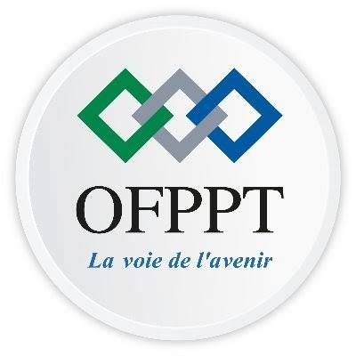
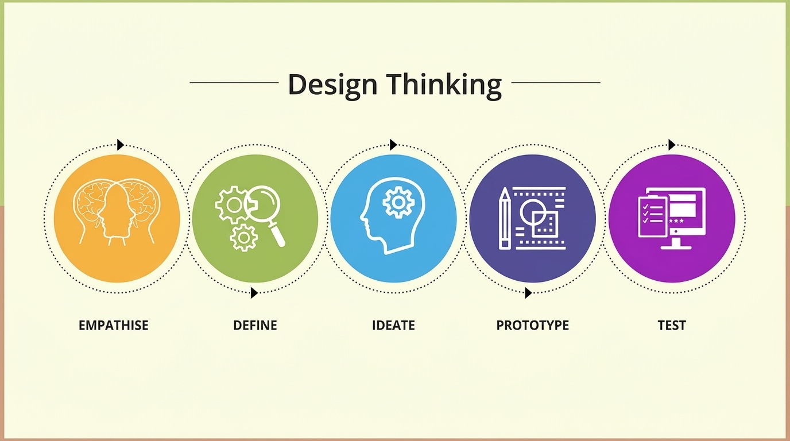
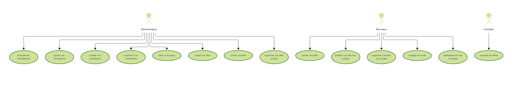
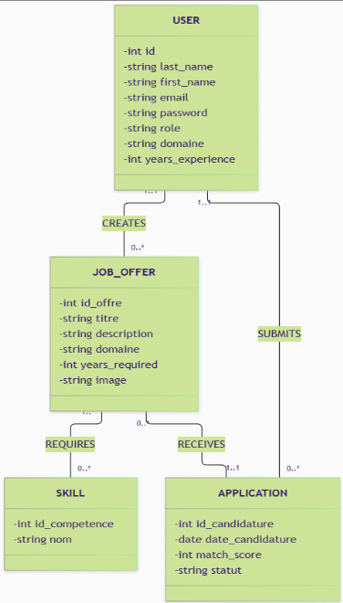
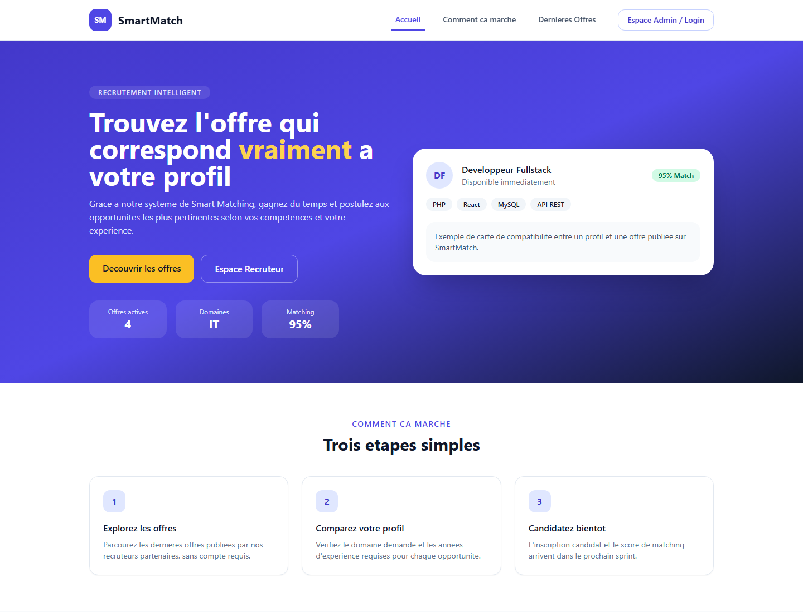
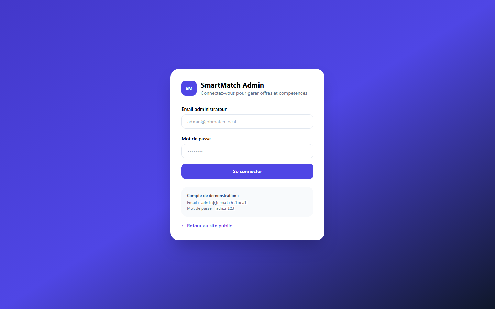
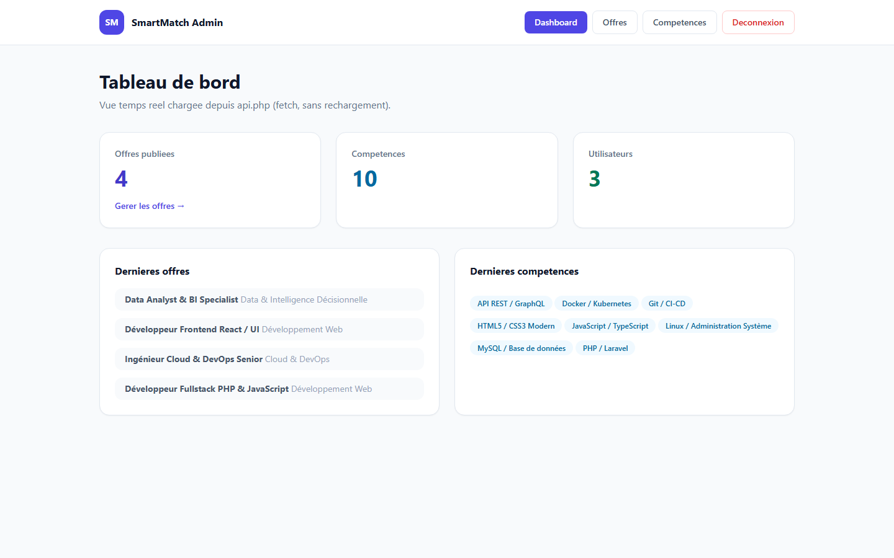
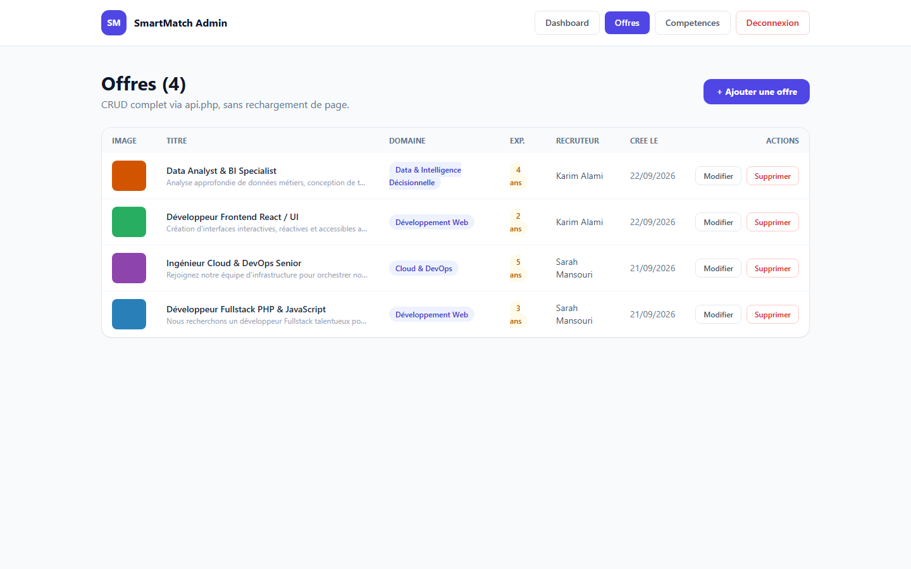
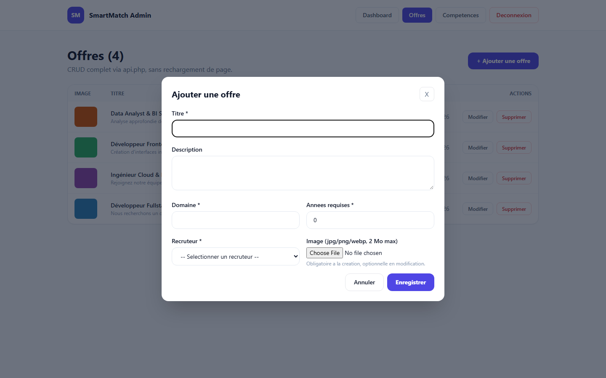

<!-- _class: title-slide -->
<!-- _paginate: false -->

  
  

  
Projet fil rouge · Développement Web

  <h1>SmartMatch</h1>
  
Plateforme de Recrutement Intelligent

  

  

    Réalisé par
    <strong>Marwan Bouhamid</strong>
  

  

    Encadré par
    <strong>ES-SARRAJ Fouad</strong>
  

---

## Sommaire

1. Contexte et objectifs du projet
2. Méthodologie : Scrum, 2TUP et Design Thinking
3. Planification et branche fonctionnelle
4. Conception technique : architecture, données et classes
5. Réalisation : maquettes
6. Bilan et perspectives

---

## Introduction

**SmartMatch** est une plateforme de recrutement intelligent qui met en relation les candidats et les offres d'emploi à partir du profil, du domaine et des compétences.

---

## Contexte du projet

Aujourd'hui, la recherche d'emploi reste **chronophage et peu ciblée** :

- Les offres sont dispersées sur de multiples plateformes et difficiles à comparer.
- Les candidats ont du mal à évaluer leur adéquation avec une offre.
- Les recruteurs reçoivent de nombreuses candidatures peu qualifiées.
- Les administrateurs manquent d'outils pour structurer le référentiel de compétences.

**SmartMatch** centralise les offres, les compétences et les utilisateurs dans un espace unique, avec un accès adapté à chaque rôle.

---
<!-- _class: image-only -->

## Scrum

---
<!-- _class: image-only -->

## Processus 2TUP

---
<!-- _class: image-only -->

## Design Thinking

---

<!-- _class: compact -->

## Planification

| Sprint | Période | Objectif | Livrable |
|---|---|---|---|
| **Sprint 1** | 22 sept. 2026 | Socle : page publique et espace admin | CRUD offres et compétences (MySQL / PDO) — `Season-1` |
| **Sprint 2** | 04 oct. 2026 | Refactorisation orientée objet | API REST JSON et frontend dynamique — `Session-2` |
| **Sprint 3** | 12 nov. 2026 | Sécurité et administration | Authentification, sessions, tableau de bord, uploads — `Session-3` |
| **Sprint 4** | 17 nov. 2026 | Documentation et soutenance | Rapport, diagrammes et présentation — `Session-4` |

---

## Branche fonctionnelle

| Acteur | Besoins | Fonctions principales |
|---|---|---|
| **Candidat** | Trouver une offre adaptée à son profil | Consulter les offres, créer un profil, postuler |
| **Recruteur** | Publier et suivre ses offres | Créer, modifier et supprimer une offre ; consulter les candidatures |
| **Administrateur** | Structurer et modérer la plateforme | Gérer les compétences, les recruteurs et les publications |

**Périmètre livré** · Consultation publique et espace administrateur (offres, compétences, utilisateurs). Les candidatures et le score de matching constituent la prochaine itération.

---

<!-- _class: compact -->

## Carte d'empathie

| Axe | Candidat | Recruteur |
|---|---|---|
| **Pense** | « Je perds du temps à trier les offres. » | « Je reçois trop de profils non qualifiés. » |
| **Voit** | Des offres dispersées et peu comparables. | Des candidatures difficiles à comparer. |
| **Ressent** | Un doute sur l'adéquation de son profil. | Une charge de tri et de publication. |
| **Attend** | Des recommandations claires et rapides. | Des candidats ciblés et un suivi simple. |

---

<!-- _class: statement -->

## Définition du problème

> Comment aider un candidat à identifier rapidement les offres réellement adaptées à son profil, tout en permettant aux recruteurs de publier et de gérer leurs offres efficacement ?

- **Enjeu** · Passer d'une recherche par mots-clés à une mise en relation par profil.
- **Cible** · Un parcours simple, transparent et responsive pour les trois acteurs.
- **Résultat attendu** · Un temps de recherche réduit et des candidatures plus pertinentes.

---

<!-- _class: compact -->

## Idéation

**Solutions explorées**

- Matching par domaine, années d'expérience et compétences.
- Référentiel unique de compétences géré par l'administrateur.
- Tableaux de bord et permissions adaptés à chaque rôle.
- API REST et interface dynamique sans rechargement.
- Upload et gestion des images des offres.
- Modération des offres avant publication.

**Priorisation** · MVP livré : consultation des offres, authentification admin, CRUD offres et compétences. Évolutions : inscription candidat, candidatures, score de matching et notifications.

---

<!-- _class: wide-image -->

## Diagramme de cas d'utilisation

- **Candidat** · consulter les offres
- **Recruteur** · gérer ses offres et son profil
- **Administrateur** · gérer les compétences, les recruteurs et les publications

---

## Stack technologique

- **Backend** · PHP 8+ · Architecture DAO & Services · Contrôleurs orientés objet
- **API** · REST API native en PHP avec gestion des en-têtes JSON et CORS
- **Frontend** · HTML5 · Tailwind CSS · JavaScript (Vanilla ES6) · Modules dynamiques
- **Stockage** · Fichiers JSON sécurisés (gestion concurrente avec verrouillage `flock`)
- **Outils & Diagrammes** · Mermaid · PlantUML · Git

---

## Prototype SmartMatch

- **Offres d'emploi** · Titre, description, domaine, années d'expérience, image
- **Compétences** · Référentiel des compétences techniques (PHP, React, Docker, etc.)
- **CRUD complet** · Création, consultation, modification et suppression
- **Espace Administrateur** · Tableau de bord sécurisé et gestion des recruteurs
- **Gestion des médias** · Upload d'images pour les offres d'emploi

---

## Relations des données

- **Utilisateur / Recruteur** → gère plusieurs offres d'emploi
- **Offre d'emploi** → rattachée à un recruteur et associée à des critères de compétences
- **Compétence** → référentiel global évaluable dans les profils et offres

---

## Structure technique

- **Frontend** · `frontend/` (Pages publiques et administration, composants JS modulaires)
- **Backend** · `backend/` (Contrôleurs, Services, DAO, Helpers, Bootstrap)
- **API** · Endpoints REST centralisés dans `backend/api/`
- **Données** · Fichiers JSON stockés dans `backend/data/` avec gestion d'uploads d'images

---

<!-- _class: split-left -->

## Diagramme de classes

- **USER** · Recruteur : profil, rôle, domaine, expérience
- **JOB_OFFER** · Offre publiée par le recruteur
- **SKILL** · Compétence liée à une offre
- **APPLICATION** · Candidature à une offre

---

<!-- _class: gallery -->

## Maquettes

| Espace public | Espace administrateur |
|---|---|
|  |  |
| Page d'accueil responsive · hero, parcours en trois étapes et aperçu des offres | Connexion sécurisée · accès réservé à l'administrateur |

---

<!-- _class: gallery three -->

## Interfaces

| Tableau de bord | Gestion des offres | Formulaire d'offre |
|---|---|---|
|  |  |  |
| Statistiques en temps réel · offres, compétences et utilisateurs | CRUD complet · image, domaine, expérience et recruteur | Création et modification · validation et upload d'image |

---

## Conclusion

- **Prototype fonctionnel** · Parcours public, espace admin sécurisé, CRUD offres et compétences, upload d'images.
- **Architecture maîtrisée** · PHP orienté objet, API REST JSON et séparation contrôleur / service / DAO, sans framework lourd.
- **Compétences mobilisées** · Analyse des besoins, UML, développement web, Git et méthodes agiles.
- **Perspectives** · Inscription candidat, candidatures, score de matching, base MySQL et authentification JWT.

**Merci de votre attention.**
